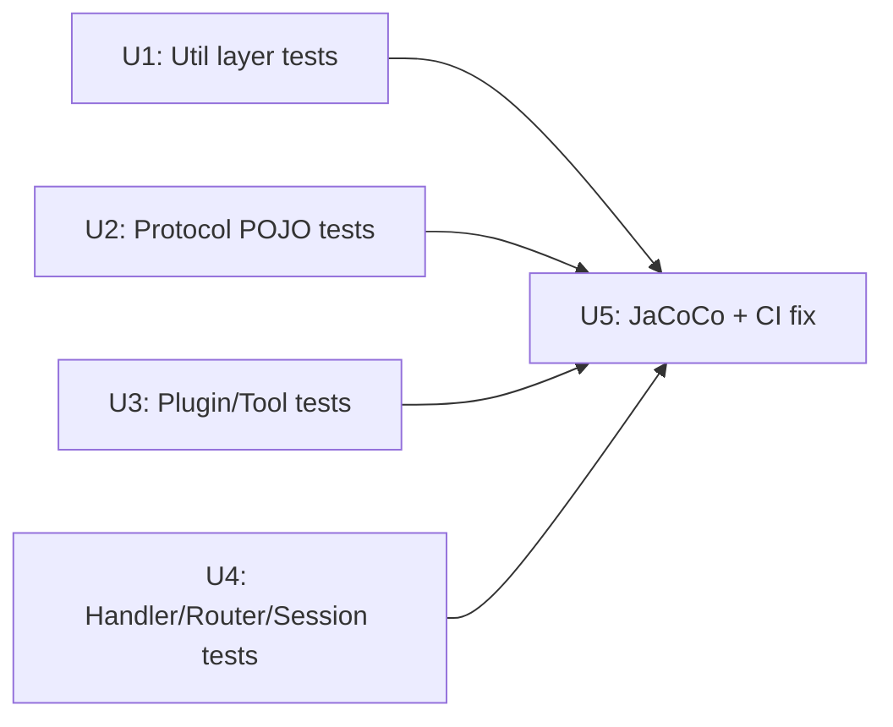

# feat: Add JUnit5/Mockito test automation with coverage reporting

## Summary

This repo's `pom.xml` already declares JUnit 5, Mockito, and OkHttp as test dependencies, and `.github/workflows/maven.yml` already runs `mvn test` — but `src/test` is completely empty. Zero tests exist today. This plan introduces the first real test suite for the hand-built MCP server: unit tests for pure logic (URL builder, JSON parser, protocol POJOs), plugin/tool tests, handler/router tests that exercise JSON-RPC request→response shapes without a live HTTP server, JaCoCo coverage reporting, and a one-line CI fix so the existing GitHub Actions workflow actually runs (it currently targets branch `main`, but this repo's branch is `master`).

**Update (2026-06-16):** This plan originally included a unit (U3) to add constructor-injection seams to `AmazonPlugin` and `SearchJobsTool`, since neither had one at the time this plan was first written. That refactor has since been implemented separately and more broadly — see `docs/plans/2026-06-16-002-refactor-dependency-injection.md` — and now covers the entire dependency graph (`AmazonPlugin`, `SearchJobsTool`, `SearchJobsHandler`, `McpRouter`, `SessionStore`, wired from a Composition Root in `McpServer.main()`), confirmed working end-to-end against the live Amazon Jobs API. This plan has been updated to reflect that: the old U3 is removed, the remaining units are renumbered (old U4→U3, U5→U4, U6→U5), and KTD1/KTD2 are rewritten to describe the seams as they actually exist rather than as originally proposed.

This is a learning project — the plan is written to teach *why* each testing technique is chosen, not just to produce passing tests.

## Problem Frame

The server has no automated way to catch regressions. Every verification so far has been manual (curl, a real Claude Code client, Docker run). Several classes have non-obvious behavior — Jackson `JsonNode` navigation that throws `NullPointerException` on malformed input, a request-id fallback that silently defaults to `1` for non-integer ids, `CompletableFuture`-based exception isolation in the plugin fan-out — that would benefit from being pinned down by tests, including tests that intentionally **characterize current behavior** (bugs and all) rather than silently fixing it mid test-plan.

One structural reality still shapes this plan:
- **The existing CI workflow never runs.** `.github/workflows/maven.yml` triggers on `branches: [ "main" ]`, but the repository's actual (and only) branch is `master`. Without fixing this, every test written in this plan would pass locally but never execute in CI — undermining the entire point of test automation.

(The other structural reality this plan originally opened with — no dependency injection anywhere in production code, blocking unit tests on `AmazonPlugin`/`SearchJobsTool` — has since been resolved by a separate, broader refactor; see the Update note above.)

## Requirements

- R1: Pure-logic utility classes (`AmazonJobSearchUrlBuilder`, `util/AmazonJobParser`, `JsonUtil`) have direct unit test coverage with no mocking.
- R2: Protocol POJOs (`JsonRpcRequest`, `JsonRpcResponse`, `ErrorObject`) have construction and Jackson serialization/deserialization coverage, including the `JsonNode`-typed `params`/`result` fields.
- R3: `AmazonPlugin` and `SearchJobsTool` have unit test coverage exercised through their existing constructor-injection seams (`AmazonPlugin(HttpClient)`, `SearchJobsTool(List<JobPlugin>)`), added by a separate prior refactor — see Update note above.
- R4: Handler classes (`InitializeHandler`, `ToolsListHandler`, `ErrorHandler`, `SearchJobsHandler`) and `McpRouter` have tests that verify JSON-RPC response shape without starting a real Javalin server.
- R5: `SessionStore`'s add/get/remove lifecycle is covered. (`SessionStore` is now instance-based with no shared state, so no special cross-test cleanup is required — each test simply constructs its own instance.)
- R6: Code coverage is measured via JaCoCo and a human-readable report is produced on every `mvn test`/`mvn package` run, so coverage can be monitored over time (no enforced minimum threshold in this plan).
- R7: The GitHub Actions workflow's branch trigger is corrected from `main` to `master` so the test suite (and its coverage report) actually executes on push/PR.

## Key Technical Decisions

**KTD1 — `Mockito.mockStatic` is used nowhere in this design; the thread-safety lesson is preserved as a worked example instead.** Mockito 5.10.0 ships the inline mock-maker by default, so `mockStatic(...)` would work without extra configuration — but it doesn't apply anywhere in this codebase: a separate, prior refactor (`docs/plans/2026-06-16-002-refactor-dependency-injection.md`) already converted every relevant class from static methods/state to constructor-injected instances (`AmazonPlugin`, `SearchJobsTool`, `SearchJobsHandler`, `McpRouter`, `SessionStore`), all wired from a single Composition Root in `McpServer.main()`. `mockStatic` only intercepts static calls, so it has no target left to intercept. `SearchJobsHandlerTest` (U4) instead uses plain `mock(SearchJobsTool.class)`, injected into `SearchJobsHandler`'s constructor. The thread-locality lesson this decision was originally built around is still worth keeping as an explicit caveat for future work: `MockedStatic` registration is thread-local, so if `mockStatic` is ever introduced elsewhere in this codebase, it must never be used to fake collaborators called from inside `SearchJobsTool`'s own `CompletableFuture.supplyAsync` lambda, because the lambda runs on a different thread (the common ForkJoinPool) and a static mock registered on the test thread is invisible there.

**KTD2 — Constructor injection over mocking the JDK's `HttpClient` (already implemented by a prior refactor, not by this plan).** Research confirmed `java.net.http.HttpClient.send(...)` is an instance call with no realistic Mockito seam, and there's no point mocking an instance nothing can substitute. The seams this plan needs already exist, built by `docs/plans/2026-06-16-002-refactor-dependency-injection.md`:
- `AmazonPlugin(HttpClient client)` — injectable for tests — plus a no-arg constructor that builds a real `HttpClient` for production, since "use a real `HttpClient`" isn't an architectural decision worth forcing into the Composition Root.
- `SearchJobsTool(List<JobPlugin> plugins)` — the *only* constructor. No no-arg constructor and no static factory (e.g. `withDefaultPlugins()`) exist or are planned, by deliberate choice: deciding *which* concrete `JobPlugin`s to use is a real architectural decision, and that decision belongs solely in `McpServer.main()`, not hidden behind a convenience method on the class.
- `SearchJobsHandler(SearchJobsTool searchJobsTool)` — likewise the only constructor, for the same reason. `SearchJobsHandlerTest` injects `mock(SearchJobsTool.class)` directly; there's no no-arg path to fall back to or shadow.

This plan's test units consume those seams as-is; no production code changes are required to enable U3/U4 below.

**KTD3 — Direct same-package calls preferred over `SseClient` mocking where possible.** `InitializeHandler`, `ToolsListHandler`, and `ErrorHandler` expose a package-visible `getResponse(JsonRpcRequest)` that can be called directly from a same-package test class, bypassing the need to mock Javalin's concrete `SseClient` entirely. Only `SearchJobsHandler` (which overrides `handle()` directly, with no `getResponse()` seam) requires `mock(SseClient.class)` + `ArgumentCaptor<String>` to capture and assert on the JSON sent via `sendEvent`.

**KTD4 — Characterization tests for two known-but-unfixed quirks.** Research surfaced two latent behaviors that are out of scope to *fix* here but valuable to *pin down*: (a) `SearchJobsHandler` throws `NullPointerException` rather than a graceful JSON-RPC error when `arguments` or `name` is missing from `params`; (b) `InitializeHandler`/`ToolsListHandler`/`ErrorHandler` silently default the response `id` to `1` when the request's `id` is not an `Integer` (e.g., a spec-legal string id). Both get explicit test cases asserting *current* behavior, each annotated with a comment flagging it as a known gap rather than intended design — a deliberate teaching pattern (tests as documentation of reality, including warts) distinct from "writing a passing test to hide a bug."

**KTD5 — JaCoCo bound to the standard Maven lifecycle, no enforced threshold.** `jacoco-maven-plugin` (0.8.12 or latest 0.8.x compatible with Java 21 bytecode — confirm exact version at implementation time) binds `prepare-agent` before `test` and `report` after `test`, producing `target/site/jacoco/index.html`. The user wants to *monitor* coverage over time, not gate the build on it yet, so no `jacoco:check` minimum-coverage rule is added — that's a natural follow-up once a baseline exists. **Trade-off to be explicit about:** without a `jacoco:check` gate, coverage has no automated enforcement — a future change could drop coverage and nothing in CI would flag it; monitoring is manual (someone opens the HTML report, or the optional CI artifact from U5) rather than automatic. That's an accepted gap for this plan, not an oversight — adding the gate is called out explicitly under Deferred to Follow-Up Work below.

**KTD6 — Dead/duplicate code excluded from new test coverage.** `plugins/AmazonJobParser.java` (unused duplicate of `util/AmazonJobParser.java`) and `plugins/AmazonJobSearchService.java` (superseded, referenced only in commented-out code) get no new tests, consistent with the earlier decision to leave them in place untouched. Only the live `util/AmazonJobParser.java` is tested.

---

## Output Structure

```
src/test/java/com/jobsearch/mcpserver/
├── util/
│   ├── AmazonJobSearchUrlBuilderTest.java
│   ├── AmazonJobParserTest.java
│   └── JsonUtilTest.java
├── protocol/
│   ├── JsonRpcRequestTest.java
│   ├── JsonRpcResponseTest.java
│   └── ErrorObjectTest.java
├── plugins/
│   ├── AmazonPluginTest.java
│   └── JobListingTest.java
├── tools/
│   └── SearchJobsToolTest.java
├── handlers/
│   ├── InitializeHandlerTest.java
│   ├── ToolsListHandlerTest.java
│   ├── ErrorHandlerTest.java
│   └── SearchJobsHandlerTest.java
└── transport/
    ├── McpRouterTest.java
    └── SessionStoreTest.java
```

This mirrors the existing `src/main/java` package layout one-for-one — Maven/Surefire convention, no configuration needed beyond the defaults already in `pom.xml`.

---

## High-Level Technical Design

**Test technique by class** — which seam (if any) each class needs, and why:

| Class | Technique | Why |
|---|---|---|
| `AmazonJobSearchUrlBuilder` | Direct call | Pure builder, no I/O |
| `util/AmazonJobParser` | Direct call | Pure function, deterministic |
| `JsonUtil` | Direct call | Pure wrapper, no mocking adds value |
| `JsonRpcRequest`/`JsonRpcResponse`/`ErrorObject` | Direct construction + Jackson round-trip | Plain POJOs |
| `InitializeHandler`/`ToolsListHandler`/`ErrorHandler` | Direct call to package-visible `getResponse()` | Bypasses `SseClient` entirely |
| `SearchJobsHandler` | `mock(SseClient.class)` + `ArgumentCaptor` + `mock(SearchJobsTool.class)` injected via constructor | No `getResponse()` seam; `SearchJobsTool` is instance-based, so a plain instance mock works (no `mockStatic` needed) |
| `McpRouter` | `mock(SseClient.class)` + `ArgumentCaptor`/`verifyNoInteractions`; constructed with a real or mock `SearchJobsHandler` | Dispatch logic only observable via what reaches the client; `McpRouter` now requires constructor injection |
| `SessionStore` | Direct call against a fresh instance per test | Instance-based, no shared state — no reset/cleanup method needed |
| `AmazonPlugin` | Constructor-injected `HttpClient` (KTD2) | Existing DI seam unlocks real coverage |
| `SearchJobsTool` | Constructor-injected `List<JobPlugin>` (KTD2) + `mock(JobPlugin.class)` | Existing DI seam unlocks real coverage |

**Sequencing** (dependency-ordered):



All required constructor-injection seams already exist (built by a separate, prior refactor — see Update note above), so U1–U4 have no production-code prerequisites and no dependencies on each other; all four can start immediately and in any order or in parallel. U5 (coverage + CI fix) goes last since it reports on whatever suite exists by then, but the CI branch-name fix itself has no code dependency and could be cherry-picked earlier if useful.

---

### U1. Util Layer Unit Tests

**Goal:** Establish the test directory structure and cover the three pure, dependency-free utility classes — the easiest and safest place to start.

**Requirements:** R1

**Dependencies:** None

**Files:**
- `src/test/java/com/jobsearch/mcpserver/util/AmazonJobSearchUrlBuilderTest.java` (new)
- `src/test/java/com/jobsearch/mcpserver/util/AmazonJobParserTest.java` (new)
- `src/test/java/com/jobsearch/mcpserver/util/JsonUtilTest.java` (new)

**Approach:** No mocking anywhere in this unit — every method under test is a pure function of its inputs. `AmazonJobSearchUrlBuilderTest` asserts on the exact built URL string (param order is deterministic, insertion-ordered via `LinkedHashMap`) including a dedicated case for `URLEncoder`'s space-to-`+` encoding behavior, which is a common gotcha worth pinning down explicitly. `AmazonJobParserTest` feeds hand-built JSON strings (lifted from the class's own `main()` demo literal) covering normal, missing-field, and missing-array shapes. `JsonUtilTest` exercises both the happy path and the wrap-and-rethrow-as-`RuntimeException` behavior on malformed JSON.

**Patterns to follow:** `util/AmazonJobParser.java`'s own `main()` method already contains a usable sample JSON fixture — lift it directly rather than inventing a new one.

**Test scenarios:**
- *Happy path:* `AmazonJobSearchUrlBuilder` default `build()` produces the documented default URL with params in `radius, offset, result_limit, sort, loc_group_id, loc_query, base_query` order.
- *Happy path:* `withBaseQuery(...)`, `withOffset(...)`, `withResultLimit(...)` overrides reflect in the built URL/URI.
- *Edge case:* `withBaseQuery("Software Development Manager")` (a value containing a space) encodes the space as `+`, not `%20`.
- *Happy path:* `AmazonJobParser.parse(json)` on a well-formed `jobs` array returns one `JobListing` per entry with title/company/location/description/url/source mapped correctly.
- *Edge case:* `parse(json)` where a job entry has a missing/null field (e.g., no `description_short`) returns `""` for that field rather than throwing.
- *Edge case:* `parse(json)` where `job_path` is empty produces an empty `absoluteUrl` rather than a malformed concatenation.
- *Edge case:* `parse(null)` and `parse("")` return `Collections.emptyList()`.
- *Edge case:* `parse(json)` where the top-level `jobs` key is missing or not an array returns an empty list rather than throwing.
- *Happy path:* `JsonUtil.fromJson(validJson, SomePojo.class)` returns a correctly populated POJO.
- *Error path:* `JsonUtil.fromJson(malformedJson, SomePojo.class)` throws `RuntimeException` with message `"Failed to parse JSON"` and a non-null cause.

**Verification:** `mvn test -Dtest=AmazonJobSearchUrlBuilderTest,AmazonJobParserTest,JsonUtilTest` passes with no production code changes required.

---

### U2. Protocol POJO Tests

**Goal:** Cover the JSON-RPC message POJOs, including their `JsonNode`-typed fields and Jackson (de)serialization behavior.

**Requirements:** R2

**Dependencies:** None

**Files:**
- `src/test/java/com/jobsearch/mcpserver/protocol/JsonRpcRequestTest.java` (new)
- `src/test/java/com/jobsearch/mcpserver/protocol/JsonRpcResponseTest.java` (new)
- `src/test/java/com/jobsearch/mcpserver/protocol/ErrorObjectTest.java` (new)

**Approach:** Build `JsonNode` fixtures via `ObjectMapper.readTree(...)` (not `JsonNodeFactory` from scratch — closer to how the real `params` arrives) for `params`/`result`. Round-trip each POJO through `ObjectMapper.writeValueAsString` → `readValue` to confirm `@JsonInclude(NON_NULL)` and `@JsonIgnoreProperties(ignoreUnknown = true)` (on `JsonRpcRequest` only) behave as expected — note `JsonRpcResponse`/`ErrorObject` lack `ignoreUnknown`, which is worth a test confirming unknown properties on those two *do* fail deserialization, since that asymmetry is a real (if minor) inconsistency worth knowing about, not silently working around.

**Test scenarios:**
- *Happy path:* `JsonRpcRequest` deserializes a full `tools/call` request (per the documented `params: { name, arguments: { query } }` shape) with `getParams().get("name").asText()` and nested `arguments.query` both readable.
- *Happy path:* `JsonRpcRequest` deserializes a notification (no `id` field) with `getId()` returning `null`.
- *Edge case:* `JsonRpcRequest` deserializes successfully when extra/unknown top-level fields are present (covers `ignoreUnknown = true`).
- *Happy path:* `JsonRpcResponse` serializes with `result` present and `error` omitted (and vice versa), confirming `NON_NULL` suppresses the unset field.
- *Error path:* `JsonRpcResponse`/`ErrorObject` deserialization fails (throws) on an unrecognized property, demonstrating the missing `ignoreUnknown` on these two types.
- *Happy path:* `ErrorObject` round-trips `code` (int) and `message` (String) correctly.

**Verification:** All three test classes pass; the unknown-property asymmetry between `JsonRpcRequest` and the other two POJOs is explicitly asserted, not just implied.

---

### U3. Plugin & Tool Layer Unit Tests

**Goal:** Exercise `AmazonPlugin`'s HTTP-call-and-parse flow and `SearchJobsTool`'s async fan-out/exception-isolation logic in true isolation, using the constructor-injection seams that already exist (KTD2).

**Requirements:** R3

**Dependencies:** None — the seams this unit needs already exist (see Update note and KTD2)

**Files:**
- `src/test/java/com/jobsearch/mcpserver/plugins/AmazonPluginTest.java` (new)
- `src/test/java/com/jobsearch/mcpserver/plugins/JobListingTest.java` (new)
- `src/test/java/com/jobsearch/mcpserver/tools/SearchJobsToolTest.java` (new)

**Approach:** For `AmazonPluginTest`, inject an `HttpClient` whose mocked `send(...)` returns a pre-built `HttpResponse` (Mockito can mock `HttpResponse<String>` directly, since it's only used as a return value, not subjected to JDK's internal dispatch) via the existing `AmazonPlugin(HttpClient)` constructor, and assert on `AmazonPlugin.search(...)`'s response-handling/parsing logic. This is the primary technique, not a fallback: `AmazonJobSearchUrlBuilder.BASE_URL` is a hardcoded `private static final String` with no constructor/setter/override seam, so a local stub HTTP server (the originally-considered alternative, e.g. JDK's `com.sun.net.httpserver.HttpServer`) cannot be reached without an additional production change beyond the constructor seam already in place — out of scope here. Revisit the stub-server approach only if `AmazonJobSearchUrlBuilder`'s base URL becomes parameterizable in a future change. For `SearchJobsToolTest`, inject `mock(JobPlugin.class)` instances via the existing `SearchJobsTool(List<JobPlugin>)` constructor and assert on `execute(...)`'s final result, including the case where one mock throws and the overall result still contains the other plugin's listings — proving the existing exception-isolation logic (already in code today) actually works, now provably, instead of by inspection.

**Execution note:** Test-first is a reasonable fit here — write the exception-isolation test before confirming it passes, since the logic already exists and should already be green; this is a good "lock in existing correct behavior" exercise rather than a true TDD red/green cycle.

**Test scenarios:**
- *Happy path:* `AmazonPlugin.search(query)` with an injected `HttpClient` returning a canned 200 response with a valid `jobs` JSON body returns the expected `List<JobListing>`.
- *Error path:* injected `HttpClient` returns a non-200 status → `search(query)` returns an empty list (matches current swallow-and-log behavior) rather than throwing.
- *Error path:* injected `HttpClient.send(...)` throws `IOException` → `search(query)` returns an empty list, matching current behavior.
- *Happy path:* `SearchJobsTool` constructed with two mock plugins that both return listings → `execute(query)` returns the combined list from both.
- *Integration scenario:* one mock plugin throws, the other returns listings → `execute(query)` returns only the successful plugin's listings (proves the per-future try/catch isolation, not just that *a* future completed).
- *Edge case:* `SearchJobsTool` constructed with an empty plugin list → `execute(query)` returns an empty list without error.
- *Happy path:* `JobListing` constructor populates all six fields and each getter returns the value passed in.

**Verification:** All three test classes pass with zero live network calls (confirm via running with network disabled or simply by inspecting that no real `amazon.jobs` host appears in the injected client/mocks).

---

### U4. Handler, Router, and Session Tests

**Goal:** Cover JSON-RPC request→response shape for every handler, `McpRouter`'s dispatch logic, and `SessionStore`'s lifecycle — including two deliberate characterization tests for known-but-unfixed quirks (KTD4).

**Requirements:** R4, R5

**Dependencies:** None — `SearchJobsHandler`'s injectable-`SearchJobsTool` constructor and `McpRouter`'s injectable-`SearchJobsHandler` constructor already exist; all six test classes in this unit can start immediately.

**Files:**
- `src/test/java/com/jobsearch/mcpserver/handlers/InitializeHandlerTest.java` (new)
- `src/test/java/com/jobsearch/mcpserver/handlers/ToolsListHandlerTest.java` (new)
- `src/test/java/com/jobsearch/mcpserver/handlers/ErrorHandlerTest.java` (new)
- `src/test/java/com/jobsearch/mcpserver/handlers/SearchJobsHandlerTest.java` (new)
- `src/test/java/com/jobsearch/mcpserver/transport/McpRouterTest.java` (new)
- `src/test/java/com/jobsearch/mcpserver/transport/SessionStoreTest.java` (new)

**Approach:** `InitializeHandlerTest`/`ToolsListHandlerTest`/`ErrorHandlerTest` live in the same package as their subjects and call the package-visible `getResponse(request)` directly — no `SseClient` mock needed (KTD3). Each re-parses the returned JSON string back into a tree (via `ObjectMapper.readTree`) and asserts on structured fields rather than doing brittle full-string/pretty-print comparison. `SearchJobsHandlerTest` uses `@Nested` classes mapping onto the handler's two real branches (`WhenToolNameMatches`, `WhenToolNameIsUnknown`), `mock(SseClient.class)` + `ArgumentCaptor<String>` to capture what's sent, and a `mock(SearchJobsTool.class)` injected via `SearchJobsHandler`'s existing constructor (KTD1/KTD2) to stub `execute(...)`'s return value so the handler test never touches the network. `McpRouterTest` constructs `McpRouter` with a real or `mock(SearchJobsHandler.class)` via its constructor, mocks `SseClient`, and asserts on what (if anything) reaches `sendEvent(...)` for each method (`initialize`, `tools/list`, `tools/call`, `notifications/initialized` — using `verifyNoInteractions(client)` for this one, since no handler is invoked — and an unknown method falling through to `ErrorHandler`). `SessionStoreTest` constructs a fresh `new SessionStore()` per test (it's instance-based with no shared state, so no `@AfterEach` cleanup is needed) and uses a fresh random `UUID` per test case (R5).

**Execution note:** Write the two characterization tests (NPE on missing `arguments`/`name`; non-integer `id` defaulting to `1`) explicitly labeled via `@DisplayName` as documenting current behavior, not endorsing it — e.g., `@DisplayName("CURRENT BEHAVIOR (known gap): missing 'arguments' throws NPE rather than a JSON-RPC error")`.

**Test scenarios:**
- *Happy path:* `InitializeHandler.getResponse(request)` returns a JSON-RPC response with `protocolVersion`, `capabilities`, and `serverInfo` populated, `id` matching the request's integer id.
- *Edge case (characterization):* `InitializeHandler`/`ToolsListHandler`/`ErrorHandler` `getResponse(request)` where `request.getId()` is a `String` (not `Integer`) → response `id` silently defaults to `1` (documents KTD4's second known gap).
- *Happy path:* `ToolsListHandler.getResponse(request)` returns the `search_jobs` tool definition with the expected name/description/schema fields.
- *Happy path:* `ErrorHandler.getResponse(request)` returns a `-32601` method-not-found error shape.
- *Happy path:* `SearchJobsHandler.handle(request, client)` constructed with an injected `mock(SearchJobsTool.class)` whose `execute(...)` returns sample listings → captured `sendEvent("message", json)` argument parses to a JSON-RPC result with `content[0].text` containing the serialized listings and `isError: false`.
- *Error path:* `SearchJobsHandler.handle(request, client)` with an unrecognized tool name → captured event is a `-32602` error response with the expected message text.
- *Error path (characterization):* `SearchJobsHandler.handle(request, client)` with `params.arguments` missing entirely → currently throws `NullPointerException` (documents KTD4's first known gap; `assertThrows(NullPointerException.class, ...)`).
- *Happy path:* `McpRouter.route(sessionId, initializeRequestJson, client)` results in exactly one `sendEvent("message", ...)` call whose payload is a valid `InitializeResult`-shaped JSON.
- *Edge case:* `McpRouter.route(sessionId, notificationJson, client)` (`notifications/initialized`) results in zero interactions with `client` and returns `true` (is-notification).
- *Edge case:* `McpRouter.route(sessionId, unknownMethodJson, client)` results in one `sendEvent` call carrying a `-32601` error.
- *Happy path:* `SessionStore.add(id, client)` then `get(id)` returns the same client; `remove(id)` then `get(id)` returns `null`.

**Verification:** All six test classes pass; the two characterization tests pass against *current* behavior (they would need updating, not silently breaking, if those gaps are ever fixed later — a natural trigger for revisiting them).

---

### U5. Coverage Reporting and CI Fix

**Goal:** Wire JaCoCo into the Maven build for ongoing coverage monitoring (R6) and fix the CI branch-name mismatch so the whole suite — and its coverage report — actually runs on every push/PR (R7).

**Requirements:** R6, R7

**Dependencies:** None directly, but reports on whatever suite exists from U1–U4

**Files:**
- `pom.xml` (modify — add `jacoco-maven-plugin` with `prepare-agent`/`report` executions)
- `.github/workflows/maven.yml` (modify — change `branches: [ "main" ]` to `branches: [ "master" ]` for both `push` and `pull_request` triggers; optionally add a step to surface/upload the JaCoCo HTML report as a workflow artifact)

**Approach:** Bind `jacoco-maven-plugin`'s `prepare-agent` goal to a phase before `test` and `report` to a phase after `test` (the plugin's documented default execution IDs handle this with minimal explicit configuration). No coverage threshold/`jacoco:check` rule is added (KTD5) — this unit's job is visibility, not enforcement. The CI fix is a one-line change in each of the two trigger blocks; consider adding `actions/upload-artifact@v4` for `target/site/jacoco/` so coverage is browsable from each workflow run, not just locally.

**Test scenarios:**
- Test expectation: none — this unit is build/CI configuration, not application behavior. Verification is procedural (see below), not unit-test-based.

**Verification:**
- `mvn test` locally produces `target/site/jacoco/index.html` with a non-zero line-coverage percentage reflecting U1–U4's new tests.
- Pushing to `master` (or opening a PR against `master`) actually triggers the GitHub Actions workflow (confirm via the Actions tab — previously it would not trigger at all).
- The workflow's "Run Tests" step passes and, if the artifact-upload step is added, the JaCoCo report is downloadable from the run's summary page.

---

## Scope Boundaries

**In scope:** Everything described in U1–U5 above — unit tests for pure logic and protocol POJOs, plugin/tool tests using the constructor-injection seams already in place, handler/router/session tests without a live server, JaCoCo coverage reporting, and the CI branch-name fix.

**Out of scope (non-goals for this plan):**
- Full integration tests that start a real Javalin server and drive it over actual HTTP/SSE.
- Tests that call the real `amazon.jobs` API (live external dependency, non-deterministic and rate-limit-sensitive).
- Fixing the two characterization-tested quirks (NPE on malformed `tools/call` params; non-integer `id` defaulting to `1`) — they are documented, not resolved, by this plan.
- Migrating `System.out`/`System.err` logging to `slf4j-simple` (already a main-scope dependency but unused for logging).

**Why unit-level coverage is the right scope for now, not just the cheap one:** the two excluded layers (real-server integration, live-API contract tests) are also the two layers with no good testing story available *yet* — Javalin's SSE testing helpers are immature (no first-class test client; see `javalin/javalin#1546` in Sources & Research), and the live Amazon endpoint has no sandbox/contract-test mode. Building either properly is real work, not a corner being cut to save time. Unit/component coverage on every class that currently has zero tests is the highest-leverage next step regardless of that gap, and it's explicitly a floor, not a ceiling — see Deferred to Follow-Up Work below for the integration-test path once a harness exists. The residual risk this leaves — wire-format mismatches between this server and a real MCP client, or breaking changes in the live API response shape — is real and not caught by this plan; it's accepted for this iteration, not unnoticed.

### Deferred to Follow-Up Work
- Deleting or further consolidating the dead/duplicate files (`plugins/AmazonJobParser.java`, `plugins/AmazonJobSearchService.java`) — already deferred per an earlier project decision ("leave them as is now"); revisit once this plan's tests are in place, since their absence of coverage will be one more reason to finally remove them.
- Adding a `jacoco:check` minimum-coverage gate once a coverage baseline exists from this plan.
- Fixing the two characterization-tested behavior gaps (KTD4) — natural next step once they're visible via tests rather than only via code reading.
- Full live/integration test suite (in-process Javalin server + real or recorded HTTP responses) if and when the project's scope grows beyond a single plugin.

## Risks & Dependencies

- **Confirmed constraint (not a risk):** `AmazonJobSearchUrlBuilder.BASE_URL` is hardcoded with no override seam, so `AmazonPluginTest` (U3) uses `HttpResponse<String>` mocking rather than a local stub server — see U3's Approach, which states this directly rather than as a fallback.
- **Risk:** JaCoCo's bytecode instrumentation version must support Java 21 class files (confirmed available as of 0.8.11+); pin a specific 0.8.x version at implementation time rather than leaving it floating, to avoid an unexpected CI break from an unrelated JaCoCo release.

## Sources & Research

- Local repository research (`pom.xml`, all `src/main/java` classes, `.github/workflows/maven.yml`) confirmed: zero existing tests, JUnit 5.10.0/Mockito 5.10.0/OkHttp 4.12.0 already test-scoped in `pom.xml`, Surefire 3.2.2 with default conventions, and the `main`/`master` branch-trigger mismatch in CI.
- `docs/plans/2026-06-16-002-refactor-dependency-injection.md` — the separate, prior refactor that introduced the constructor-injection seams this plan relies on (KTD2), and the source of the 2026-06-16 update reflected throughout this document.
- External research on Mockito 5.x inline mock-maker, `mockStatic` thread-locality, `HttpClient` mocking limits, `CompletableFuture` testing patterns, Javalin `SseClient` mocking, and JUnit 5 `@Nested`/`@DisplayName`/AAA conventions — see Key Technical Decisions KTD1–KTD4 for where these findings shaped concrete plan choices. Notable sources: Baeldung (Mockito static mocking, CompletableFuture unit testing, `@Nested` test classes), InfoQ (Mockito 5 inline-by-default), Javalin issue tracker (`javalin/javalin#1546`, confirming no first-class SSE test helper exists yet).
