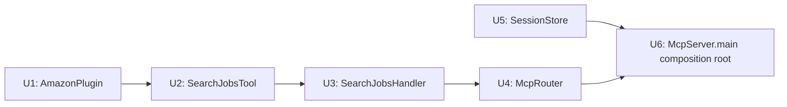

# refactor: Introduce constructor injection and eliminate static mutable state

## Summary

Every class in this codebase that has a non-trivial dependency — an `HttpClient`, a list of plugins, a `SessionStore` — currently either builds that dependency itself (hardcoded `new` inside the class body) or holds it as a `static final` field initialized at class-load time. This plan removes both patterns throughout the production code, replacing them with constructor injection and a single **Composition Root** in `McpServer.main()` where all dependencies are wired together. No framework is added — this is pure Java.

This refactor is a prerequisite to the test automation plan (`docs/plans/2026-06-16-001-feat-test-automation-plan.md`): once it lands, U3 of that plan (the "minimal seam" refactor) is fully superseded and can be dropped, and the remaining test units simplify significantly.

This is a learning project — the plan is written to teach *why* each pattern change is made, not just to produce working code.

## Problem Frame

Three structural problems exist in the current code, all caused by static state and self-constructing classes:

1. **Untestability.** `AmazonPlugin` builds its own `HttpClient` at class-load time (`private static final HttpClient HTTP_CLIENT = ...`). `SearchJobsTool.execute(...)` is a `static` method that calls `new AmazonPlugin()` directly. There is no way to substitute a test double without either hitting the live Amazon API or rewriting the call site. Any future plugin added to `SearchJobsTool` has the same problem.

2. **Hidden coupling.** When a class constructs its own dependencies, the caller can't tell what the class actually needs — that information is buried in the class body, not declared at the construction site. Constructor injection makes dependencies visible at the call site, which is where another programmer looks first.

3. **Static mutable state.** `SessionStore` holds a `private static final ConcurrentHashMap` shared across the entire JVM. This means: (a) tests cannot create an isolated instance — they share the same global map; (b) there is no way to mock or replace the store; (c) if two test cases run in the same JVM they can pollute each other's state. Non-static instance fields fix all three.

## Key Technical Decisions

**KTD1 — Constructor injection, no DI framework.** A DI framework (Guice, Dagger, Spring) would add dependency overhead, a new learning surface, and magic that hides what this plan is trying to teach. Manual constructor injection is sufficient at this project's scale: each class declares what it needs in its constructor, and `McpServer.main()` assembles everything. The pattern has a name — *Composition Root* — and understanding it in pure Java is more transferable than learning any specific framework.

**KTD2 — No-arg constructors only where the "default" isn't an architectural decision.** `AmazonPlugin`'s no-arg constructor stays — it delegates to `this(HttpClient.newHttpClient())`, and that's not a choice, it's just "use the real HTTP client." `SearchJobsTool` and `SearchJobsHandler` get no no-arg constructor at all, because their defaults *would* encode a real decision: which plugins to use, and which `SearchJobsTool` to wire in. A static convenience factory hiding that decision (e.g. a hypothetical `SearchJobsTool.withDefaultPlugins()`) would just relocate the hidden-coupling problem this refactor is removing — now two places would "know" about `AmazonPlugin` instead of one. The rule: if constructing the default requires deciding *which concrete implementation* to use, that decision belongs solely in the Composition Root (`McpServer.main()`), never in a factory method on the class itself.

**KTD3 — SessionStore becomes instance-based.** All three static methods (`add`, `get`, `remove`) and the static map field become non-static. `McpServer.main()` constructs one `SessionStore` instance and captures it in the lambda closures used by the `/sse` and `/message` handlers. This eliminates the global shared-state problem entirely.

**KTD4 — McpRouter becomes instance-based, injected with only the handler(s) that have dependencies.** `InitializeHandler`, `ToolsListHandler`, and `ErrorHandler` are stateless (they take no dependencies and hold no fields) — `McpRouter` can still instantiate these with `new` internally, or hold them as final instance fields constructed once. `SearchJobsHandler` is the only handler with a dependency (`SearchJobsTool`), so `McpRouter` receives it via constructor. This is intentionally minimal — the goal is not to inject every handler, only the ones that need it.

**KTD5 — McpServer.main() becomes the Composition Root.** The current `main()` contains inline test/demo code (raw JSON string parsing, direct `ObjectMapper` calls, a demo `SearchJobsTool.execute("software engineer")`) that was useful during early development but is now noise. This refactor is a natural opportunity to clean that up — strip the demo code, assemble the dependency graph cleanly, and let `main()` read like a wiring diagram for the application.

**KTD6 — Dead code files are untouched.** `plugins/AmazonJobParser.java` and `plugins/AmazonJobSearchService.java` remain as-is, consistent with the existing decision. They appear in no dependency graph we're restructuring here.

---

## Output Structure

No new files are created. These existing files are modified:

```
src/main/java/com/jobsearch/mcpserver/
├── McpServer.java                  ← composition root; demo/test code removed
├── transport/
│   ├── SessionStore.java           ← static map + static methods → instance
│   └── McpRouter.java              ← static route() → instance method; SearchJobsHandler injected
├── handlers/
│   └── SearchJobsHandler.java      ← SearchJobsTool.execute() call → injected field
├── tools/
│   └── SearchJobsTool.java         ← static execute() → instance method; plugin list injected
└── plugins/
    └── AmazonPlugin.java           ← static HttpClient → instance field; injecting constructor added
```

Everything else is unchanged: `BaseHandler`, `InitializeHandler`, `ToolsListHandler`, `ErrorHandler`, `JsonRpcRequest`, `JsonRpcResponse`, `ErrorObject`, `util/*`, `protocol/*`.

---

## High-Level Technical Design

**The dependency graph, after this refactor:**

```
McpServer.main()  ← Composition Root: creates and wires everything
    │
    ├── HttpClient (JDK, new here)
    │       └──▶ AmazonPlugin(HttpClient)
    │                   └──▶ SearchJobsTool(List<JobPlugin>)
    │                               └──▶ SearchJobsHandler(SearchJobsTool)
    │                                           └──▶ McpRouter(SearchJobsHandler)
    │
    └── SessionStore (new here, passed to SSE + /message lambdas)
```

Every arrow represents a constructor parameter. Every class's dependencies are fully visible at its constructor call site. No class reaches out to a static somewhere to get what it needs.

**The Composition Root pattern — how to read `McpServer.main()`:**

```
// Build bottom-up: leaves first, root last
HttpClient httpClient = HttpClient.newHttpClient();
AmazonPlugin amazonPlugin = new AmazonPlugin(httpClient);
SearchJobsTool searchJobsTool = new SearchJobsTool(List.of(amazonPlugin));
SearchJobsHandler searchJobsHandler = new SearchJobsHandler(searchJobsTool);
McpRouter router = new McpRouter(searchJobsHandler);
SessionStore sessionStore = new SessionStore();

// Then build the Javalin app using the wired-up objects
Javalin app = Javalin.create();
// ... lambdas capture router and sessionStore by reference
```

This is not a working code snippet — it's a directional sketch. The point is that `main()` becomes the only place in the codebase that uses `new` on anything with real dependencies. Everything else receives its dependencies; nothing reaches out to grab them.

---

## Sequencing



Units U1–U4 form a chain: each one depends on the previous because the dependency graph flows upward. U5 (`SessionStore`) is independent of that chain and can be done any time, but is wired in during U6. U6 is last because it rewires `McpServer.main()` to use all the newly injected constructors — it can't be done until U1–U5 have their new constructors in place.

---

### U1. De-staticify AmazonPlugin

**Goal:** Replace the class-level `static final HttpClient` with an instance field, and introduce a constructor injection seam.

**Files:**
- `src/main/java/com/jobsearch/mcpserver/plugins/AmazonPlugin.java` (modify)

**Approach:** The existing code has `private static final HttpClient HTTP_CLIENT = HttpClient.newHttpClient()` or similar at class level. This becomes `private final HttpClient httpClient` as an instance field. Two constructors:
- `AmazonPlugin()` — the production default, calls `this(HttpClient.newHttpClient())`
- `AmazonPlugin(HttpClient httpClient)` — the injectable form, sets `this.httpClient = httpClient`

The `search(String query)` method's one reference to the static `HTTP_CLIENT` changes to `this.httpClient`. No other behavior changes.

**Why the delegating no-arg constructor pattern matters:** putting the construction logic in one place (the full constructor) and having the no-arg constructor delegate to it means there's never two copies of the initialization logic to keep in sync. This is worth internalizing as a general rule.

**Test scenarios:** None for this unit alone — its correctness is demonstrated by U4 of the test plan passing against the injected constructor (not by unit tests of its own here).

**Verification:** `mvn compile` succeeds. Existing call site `new AmazonPlugin()` (in `SearchJobsTool`, before U2 changes it) still compiles unchanged.

---

### U2. De-staticify SearchJobsTool

**Goal:** Convert `SearchJobsTool` from a class with a `static execute(String query)` method into an instance-based class that receives its plugins via constructor.

**Files:**
- `src/main/java/com/jobsearch/mcpserver/tools/SearchJobsTool.java` (modify)

**Approach:** 
- Add a `private final List<JobPlugin> plugins` instance field.
- Add constructor: `SearchJobsTool(List<JobPlugin> plugins)`.
- Change `execute(String query)` from `public static List<JobListing>` to `public List<JobListing>` (remove `static`). The implementation — `CompletableFuture.supplyAsync` per plugin, `allOf`, collect and flatten — stays identical, but now it iterates over `this.plugins` instead of hardcoding `new AmazonPlugin()` inline.
- No no-arg constructor and no static factory — `SearchJobsTool` has exactly one constructor, `SearchJobsTool(List<JobPlugin> plugins)`. Deciding which plugins to use is an architectural decision, not a default; it belongs solely in `McpServer.main()` (KTD2).

**Why this change matters for testing:** today, any test of `SearchJobsTool` must test `AmazonPlugin` and live network access simultaneously — there's no seam. After this change, a test can pass `List.of(mock(JobPlugin.class))` and test only the fan-out/exception-isolation logic in complete isolation.

**Test scenarios:** None for this unit — verified via U3 of the test plan (SearchJobsToolTest).

**Verification:** `mvn compile` succeeds. The call site in `SearchJobsHandler` (`SearchJobsTool.execute(query)` — a static call) will be a compile error after this unit, which is expected and resolved in U3.

---

### U3. De-staticify SearchJobsHandler

**Goal:** Give `SearchJobsHandler` a `SearchJobsTool` instance field so it can be constructed with a real tool (production) or a mock tool (tests), and update its internal call from the old static `SearchJobsTool.execute(query)` to `this.tool.execute(query)`.

**Files:**
- `src/main/java/com/jobsearch/mcpserver/handlers/SearchJobsHandler.java` (modify)

**Approach:**
- Add `private final SearchJobsTool tool` instance field.
- Add `SearchJobsHandler(SearchJobsTool tool)` constructor — this is the only constructor; no no-arg version (same reasoning as U2: which `SearchJobsTool` to wire in is a decision for `McpServer.main()` alone, not a default this class should know how to make).
- Change the one call `SearchJobsTool.execute(query)` to `this.tool.execute(query)`.

Both production and test code call the same constructor — production passes a real `SearchJobsTool`, tests pass a `mock(SearchJobsTool.class)`. There is no second, parallel "convenience" path to keep in sync with the real one.

**Why this is better than the "minimal seam" originally planned in the test plan:** the original test plan's U3 was specifically trying to add *just enough* to make tests possible. This unit does the same thing but in the context of a coherent, principled design — the seam is a natural consequence of good design, not a workaround bolted on.

**Test scenarios:** None for this unit alone.

**Verification:** `mvn compile` succeeds. The static call `SearchJobsTool.execute(query)` in `SearchJobsHandler` is replaced; the compile error introduced in U2 is resolved.

---

### U4. De-staticify McpRouter

**Goal:** Convert `McpRouter.route(...)` from a static method to an instance method, and inject `SearchJobsHandler` so `McpRouter` doesn't hold a direct dependency on the `SearchJobsTool` construction chain.

**Files:**
- `src/main/java/com/jobsearch/mcpserver/transport/McpRouter.java` (modify)

**Approach:**
- Add `private final SearchJobsHandler searchJobsHandler` field.
- Add `McpRouter(SearchJobsHandler searchJobsHandler)` constructor.
- Change `public static boolean route(...)` to `public boolean route(...)` (remove `static`).
- Inside `route(...)`: where the current code does `new SearchJobsHandler().handle(request, client)`, use `this.searchJobsHandler.handle(request, client)` instead.
- `InitializeHandler`, `ToolsListHandler`, and `ErrorHandler` are stateless (no dependencies, no fields) — `McpRouter` can continue to instantiate these with `new` locally, or hold them as `private final` fields constructed in the constructor. Either is fine; holding them as fields is slightly cleaner and is recommended, but is not load-bearing.

**Why not inject all handlers?** Injecting all five handlers would make `McpRouter`'s constructor take five parameters, most of which convey no information (the stateless handlers have no variation between production and test use). Only `SearchJobsHandler` varies — it holds a real vs. mock `SearchJobsTool`. Injecting only the handler that has dependencies keeps the API honest: the constructor declares only what's actually variable.

**Test scenarios:** None for this unit alone.

**Verification:** `mvn compile` succeeds. The call site in `McpServer.main()` (`McpRouter.route(...)`) is now a compile error because the method is no longer static — resolved in U6.

---

### U5. De-staticify SessionStore

**Goal:** Convert `SessionStore` from a class with a static `ConcurrentHashMap` and static `add`/`get`/`remove` methods into a plain instance class.

**Files:**
- `src/main/java/com/jobsearch/mcpserver/transport/SessionStore.java` (modify)

**Approach:**
- Change `private static final ConcurrentHashMap<String, SseClient> sessions` to `private final ConcurrentHashMap<String, SseClient> sessions = new ConcurrentHashMap<>()` (instance field).
- Remove `static` from `add(String id, SseClient client)`, `get(String id)`, and `remove(String id)`.
- No logic changes — the map operations are identical.

**Why the static map is worse than it looks:** it's not just a testing problem. A static field means the store's lifetime is the JVM's lifetime, not the application's. If someone ever embeds multiple server instances in one JVM (unlikely here, but illustrative), they'd share state invisibly. An instance field makes the lifetime explicit and controllable.

**Test scenarios:** None for this unit alone — `SessionStoreTest` (test plan U4) will use a fresh `new SessionStore()` per test after this change, with no `@AfterEach` cleanup needed.

**Verification:** `mvn compile` succeeds. Call sites in `McpServer.main()` (`SessionStore.add(...)`, `SessionStore.get(...)`, `SessionStore.remove(...)`) are now compile errors — resolved in U6.

---

### U6. Assemble the Composition Root in McpServer.main()

**Goal:** Rewrite `McpServer.main()` to wire all newly-injectable dependencies together from the bottom up, producing a clean Composition Root, and remove the early-dev demo/test code that's no longer needed.

**Files:**
- `src/main/java/com/jobsearch/mcpserver/McpServer.java` (modify)

**Approach:** Strip the demo scaffolding at the top of `main()` — the inline JSON string parsing, direct `ObjectMapper` calls, the demo `SearchJobsTool.execute("software engineer")` call at the bottom. These were valuable during early development (they proved the parser worked before anything else did) but they're now noise in a production entry point and they also hold the only remaining call to the old static `SearchJobsTool.execute`, which no longer exists after U2. Replace the entire `main()` body with:

1. **Dependency construction (bottom-up):** `HttpClient` → `AmazonPlugin` → `SearchJobsTool` → `SearchJobsHandler` → `McpRouter`; and independently `SessionStore`.
2. **Javalin app construction:** exactly as today, but the SSE handler lambda captures the `sessionStore` instance, and the `/message` handler calls `router.route(...)` on the instance (not the static method).
3. `app.start(8080)` — unchanged.

The logging lines (`System.out.println("Mcp server running...")`, `app.before(...)`) should stay — they're useful operational output, not demo code.

**What this looks like conceptually (directional sketch, not implementation spec):**

```
main():
    // 1. Wire dependencies
    httpClient      = new HttpClient
    amazonPlugin    = new AmazonPlugin(httpClient)
    searchJobsTool  = new SearchJobsTool(List.of(amazonPlugin))
    searchHandler   = new SearchJobsHandler(searchJobsTool)
    router          = new McpRouter(searchHandler)
    sessionStore    = new SessionStore()

    // 2. Build app
    app = Javalin.create()
    app.before(...)  // existing request logger
    app.sse("/sse", client -> {
        sessionId = UUID.randomUUID()
        client.sendEvent("endpoint", ...)
        sessionStore.add(sessionId, client)
        client.onClose(() -> sessionStore.remove(sessionId))
        client.keepAlive()
    })
    app.post("/message", ctx -> {
        sessionId = ctx.queryParam("sessionId")
        sseClient = sessionStore.get(sessionId)
        // ... null checks ...
        isNotification = router.route(sessionId, ctx.body(), sseClient)
        ctx.status(...)
    })
    app.start(8080)
```

**Why the Composition Root belongs in `main()` specifically:** `main()` is the entry point — it runs before anything else, it owns the application's lifetime, and it's the one place that's allowed to "know" about everything. It's the right home for wiring. Putting construction logic anywhere else (in a handler, in a factory method, scattered across static initializers) distributes knowledge that should be centralized.

**Test scenarios:** None — this unit is wiring code, not logic. Verification is behavioral.

**Verification:**
- `mvn compile` succeeds — all compile errors from U2–U5 are resolved.
- `mvn package` produces `target/job-search-mcp-server.jar`.
- Running `java -jar target/job-search-mcp-server.jar` starts the server and logs the startup message.
- A real end-to-end smoke test: `claude mcp add --transport sse job-search http://localhost:8080/sse` in a new Claude Code session, then a `search_jobs` call, returns live Amazon listings — confirms no behavior regression introduced by the refactor.

---

## Scope Boundaries

**In scope:** Everything above — making `AmazonPlugin`, `SearchJobsTool`, `SearchJobsHandler`, `McpRouter`, and `SessionStore` instance-based with constructor injection; wiring them in `McpServer.main()`.

**Out of scope:**
- Adding a DI framework (Guice, Spring, Dagger, etc.) — not needed at this scale.
- Making `InitializeHandler`, `ToolsListHandler`, `ErrorHandler`, or `BaseHandler` inject anything — they have no dependencies to inject.
- Fixing the known behavior quirks (NPE in `SearchJobsHandler`, non-integer `id` defaulting to `1`) — out of scope per the test plan's KTD4, which characterizes rather than fixes them.
- Deleting the dead files (`plugins/AmazonJobParser.java`, `plugins/AmazonJobSearchService.java`) — deferred, as before.
- Any changes to the transport protocol, JSON-RPC handling, or plugin logic — this refactor must be behavior-preserving.

## Impact on the Test Automation Plan

After this refactor lands, `docs/plans/2026-06-16-001-feat-test-automation-plan.md` should be updated:

- **Drop U3 entirely** ("Testability Seam Refactor") — it is fully superseded by this plan.
- **Simplify U4** (`AmazonPluginTest`, `SearchJobsToolTest`): the approach section can drop the discussion of "primary vs. fallback" — injecting a mocked `HttpClient` is the only approach, always.
- **Simplify U5** (`SearchJobsHandlerTest`): no `mockStatic` discussion needed at all; `SessionStoreTest` no longer needs `@AfterEach` cleanup (fresh instance per test); `McpRouterTest` can inject a mock `SearchJobsHandler` directly.
- **Renumber** the remaining units: old U4 → new U3, old U5 → new U4, old U6 → new U5.
- The test plan then becomes 5 units instead of 6, and every test technique described is simpler.

## Risks & Dependencies

- **Risk:** Removing the demo/scaffold code from `McpServer.main()` in U6 is irreversible (though it's in git history). **Mitigation:** the code being removed is not real behavior — it's `System.out.println` demonstrations that were scaffolding from early development. The smoke test in U6's Verification catches any behavioral regression.
- **Risk:** Lambda variable capture — the SSE handler and POST handler lambdas in Javalin capture `sessionStore` and `router` from the enclosing scope. In Java, variables captured by lambdas must be effectively final. Constructing them as local variables before the `app` declaration and not reassigning them satisfies this automatically — just worth knowing so the implementer doesn't reach for `static` when the compiler complains about capture.
- **Dependency ordering:** U2 introduces a compile error in `SearchJobsHandler` (static call removed); U3 resolves it. U4 introduces a compile error in `McpServer.main()` (static `route(...)` removed); U6 resolves it. U5 introduces compile errors in `McpServer.main()` (static SessionStore methods removed); U6 resolves those too. The safest path is U1 → U2 → U3 → (compile check) → U4 → U5 → U6 → (full compile + smoke test). Alternatively, the implementer can batch U1–U5 without compiling between steps and only verify at U6 — both are valid.

## Sources & Research

- Design principle: *Dependency Injection* (Martin Fowler, "Inversion of Control Containers and the Dependency Injection pattern") — constructor injection as the simplest, most transparent DI form.
- Design principle: *Composition Root* (Mark Seemann, "Dependency Injection in .NET") — a single place in the application that wires the entire object graph; in Java apps without a DI container, `main()` is the natural Composition Root.
- Repository research: confirmed static fields in `AmazonPlugin`, `SessionStore`; static `execute()` in `SearchJobsTool`; static `route()` in `McpRouter`; all production call sites inventoried for U6 impact assessment.
